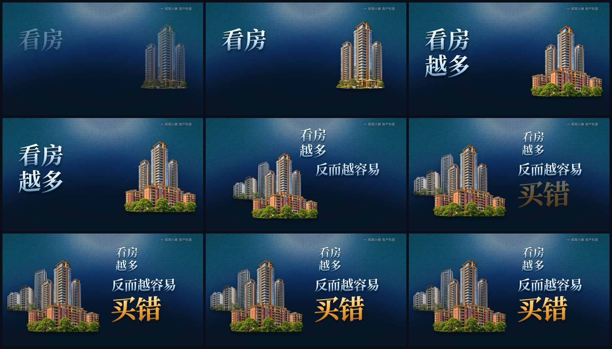
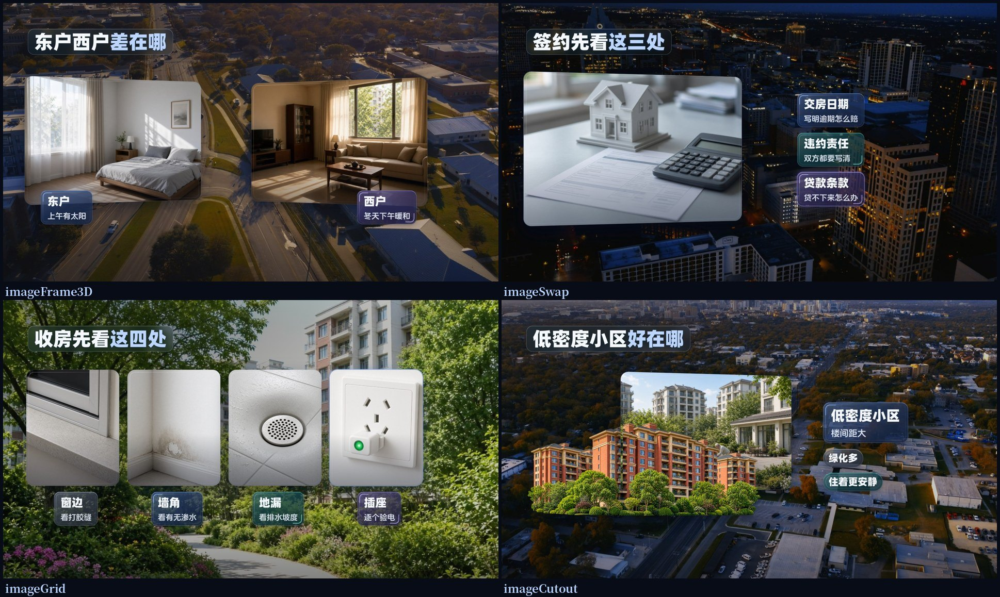
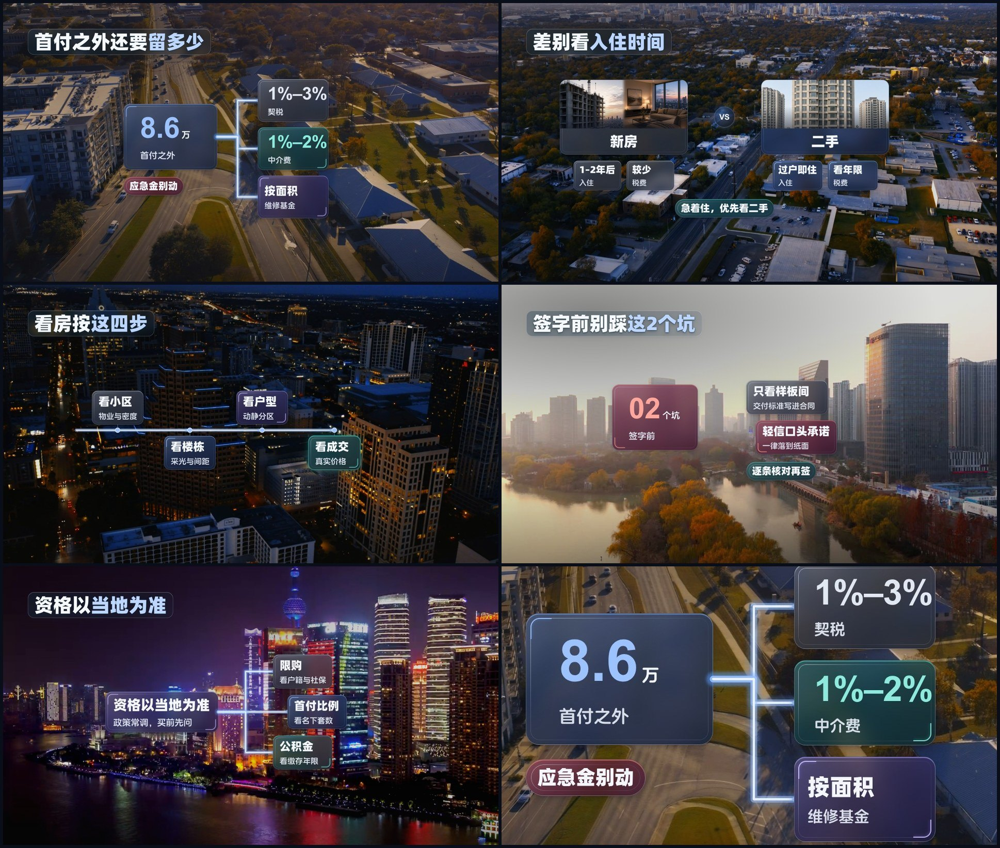
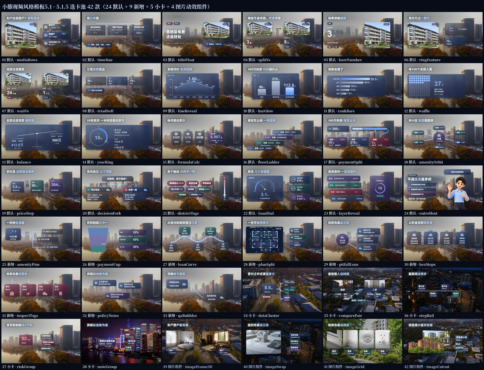
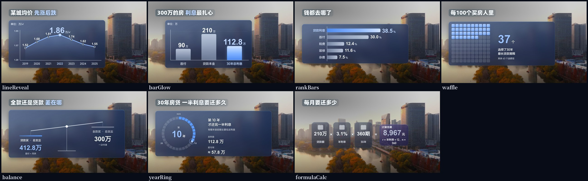
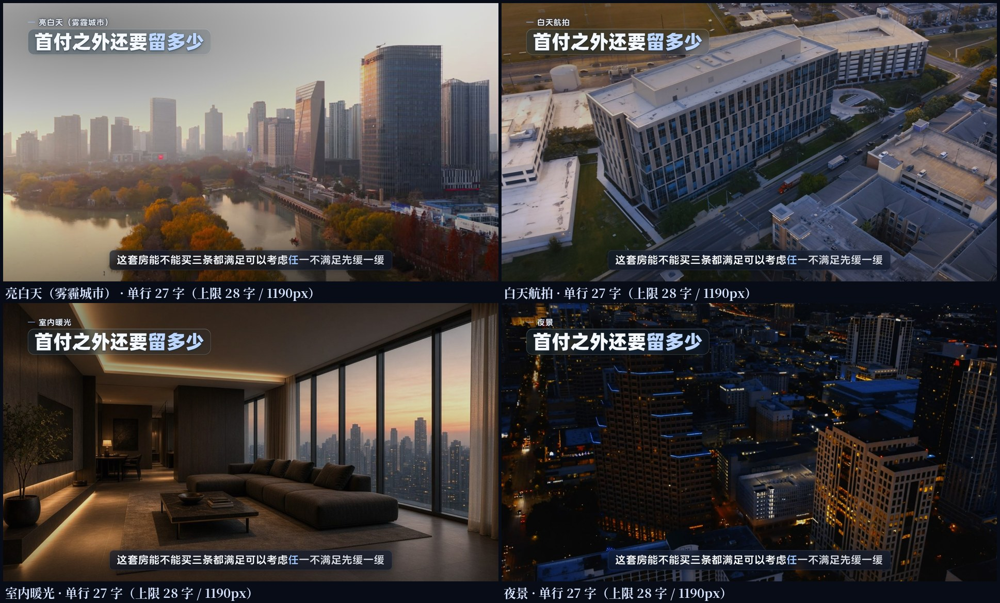

# 小滕视频风格模板5.1

与 5.0 共存的独立正片模板。视觉基准：墨蓝·电光玻璃卡、5 款小卡组合、冰蓝标题/字幕强调。标识 `5.1.5-2026-11-20「图文动效与去繁」`（片头改为 skill「小滕片头风格模板」做法且只覆盖口播第 1 句；卡面小Lin说式一词/一数 + 至多一行副句并自动适配；按逻辑飞入带轻回弹落位；饰线与卡圆角同心；新增 4 款图片动效组件，每期图片主导镜头 ≥ 1/3）。此前 `5.1.4「视觉精致度」`（在 5.1.3「计划期约束」、5.1.2「卡面内容守卫」与 5.1.1「图卡与可读性」之上：字阶与卡面比例、光影连线、简约饰线、分层入场与轻度透视、墨蓝片头创意字组；时序与播前检查沿用 5.1.3）；5.1.1 基线说明如下：（在 5.1「顺序与连线」之上：大卡放图、自绘户型图、统一字阶、无黑字、图表重做、片尾互动）。

**5.1.3 起镜头表在计划期就要定好口播起点入场、A→线→B 连线、关键词取自口播、片头一句一拍，写完先 `npm run plan:check`（静态、几秒、不渲染）。5.1.4 在此之上把连线改成光影线、卡面加饰线并重校字阶，片头改为墨蓝创意字组。**

**调用本模板前必须阅读并遵守 [AGENTS.md](AGENTS.md)（即《[模板输出约束标准](模板输出约束标准.md)》）。** 风格靠已登记版式、锁定令牌和 `npm run verify` 强制执行，不能重新设计。

- 中文调用名：小滕视频风格模板5.1
- 安装与制作入口：[SKILL.md](SKILL.md)
- 快速上手：见 AGENTS.md 第 12 节，或 [QUICKSTART.md](QUICKSTART.md)
- 出片标准：[references/出片标准.md](references/出片标准.md)
- 安装与运行：[references/安装与运行.md](references/安装与运行.md)
- 版式目录：[正片/references/版式目录.md](正片/references/版式目录.md)
- 素材规则：[正片/references/素材与生图规则.md](正片/references/素材与生图规则.md)
- 预览样张：[previews/current/](previews/current/)

源码与压缩样张随包；不打包完整成片、stock 原片、模型、node_modules、运行缓存和字体。字体按 `正片/template/scripts/resources.json` 的 URL 与 SHA256 在 `npm run setup` 时下载。依赖按锁文件安装，不自动升级。

建议仓库名（由 GitHub 仓库管理员创建，默认私有）：`pensongchs/xiaoteng-video-style-template-5.1`。
